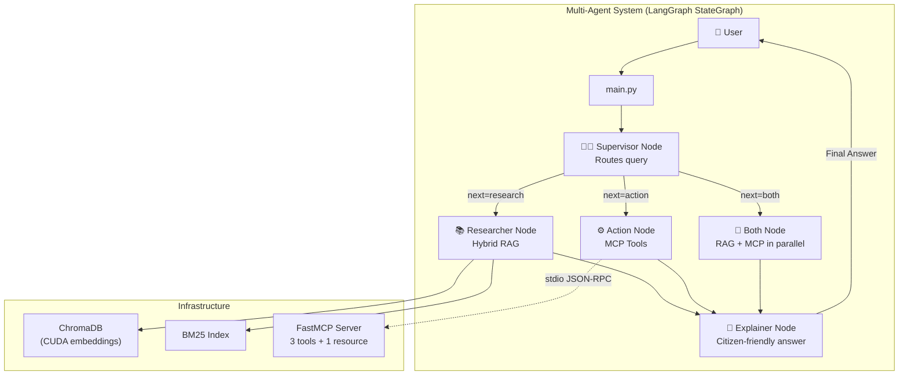

# Nyaya Sahayak — Definitive Build Plan

> **You build, I assist.** This is the single, comprehensive reference document. Every phase has exact data schemas, function signatures, test commands, and checklists. Follow it start to finish.

---

## Project Overview

**Nyaya Sahayak** (न्याय सहायक) — An AI-powered Indian law assistant combining RAG + MCP tools + Multi-Agent Orchestration. It helps Indian citizens with daily legal queries, updated for the new criminal laws (BNS 2023).

### 🚀 Optimizations Baked In
| # | Optimization | Impact |
|---|-------------|--------|
| 1 | **IPC + BNS Mapping** | Current legal relevance (BNS replaced IPC on 1 July 2024) |
| 2 | **Structural/Section-based Chunking** | Legal clauses never severed mid-sentence |
| 3 | **GPU Acceleration** | RTX 3050 via `device='cuda'` for fast embeddings |
| 4 | **True MCP Architecture** | MCP Client over `stdio` — not just Python imports |
| 5 | **Multi-Agent (LangGraph)** | Supervisor → Researcher → Action → Explainer pipeline |
| 6 | **Hybrid Search + Multi-Query** | Vector + BM25 with Reciprocal Rank Fusion |

---

## Architecture



---

## Tech Stack

| Component | Choice | Install |
|-----------|--------|---------|
| LLM | Gemini Flash | `google-genai` |
| LangChain + LangGraph | Orchestration | `langchain-google-genai`, `langgraph` |
| Embeddings | `all-MiniLM-L6-v2` (CUDA) | `sentence-transformers` |
| Vector DB | ChromaDB | `chromadb` |
| Keyword Search | BM25 | `rank_bm25` |
| MCP Server | FastMCP | `fastmcp` |
| MCP Client | Official SDK | `mcp` |
| Env Vars | dotenv | `python-dotenv` |

---

## Final Project Structure

```
nyaya-sahayak/
├── README.md                        # Domain description, setup, architecture, video link
├── requirements.txt                 # All Python dependencies
├── .env.example                     # GEMINI_API_KEY=your_key_here
├── .env                             # (gitignored) actual keys
├── .gitignore
│
├── data/
│   ├── raw/
│   │   ├── ipc_bns_mapping.json     # 50+ IPC→BNS section mappings
│   │   ├── constitution.json        # 25+ Constitution articles
│   │   ├── consumer_protection.md   # Consumer Protection Act 2019
│   │   ├── rti_act.md               # Right to Information Act 2005
│   │   ├── motor_vehicle_act.md     # Motor Vehicles Act 1988
│   │   ├── family_laws.md           # Hindu Marriage Act, Special Marriage Act
│   │   ├── property_laws.md         # Transfer of Property Act, tenancy
│   │   └── labor_laws.md            # Industrial Disputes Act, Shops & Establishment
│   └── chroma_db/                   # (auto-generated) persistent vector store
│
├── rag/
│   ├── __init__.py
│   ├── config.py                    # All constants (paths, model, device, chunk config)
│   ├── indexing.py                  # Load → structural chunk → embed → store
│   └── retrieval.py                 # Multi-query → hybrid search → RRF → generate
│
├── mcp_server/
│   ├── __init__.py
│   └── server.py                    # FastMCP: 3 tools + 1 resource
│
├── evaluation/
│   ├── test_queries.json            # 10 test questions
│   ├── evaluate.py                  # Run queries, compute metrics
│   └── results.md                   # Scores table, failure cases, improvements
│
├── examples/
│   └── demo.md                      # 3 example interactions (Thought→Action→Observation→Answer)
│
└── main.py                          # LangGraph multi-agent + MCP client + CLI
```

---
---

# PHASE 1: Project Setup & Data Collection

**Goal**: Repository, virtual environment, dependencies, and 20+ law documents.

**Estimated Time**: 2–3 hours

---

### Step 1.1: Create Project & Environment

```bash
# Create project
mkdir -p ~/Documents/projects/nyaya-sahayak
cd ~/Documents/projects/nyaya-sahayak
git init

# Create virtual environment
python3 -m venv venv
source venv/bin/activate

# Install all dependencies
pip install chromadb sentence-transformers google-genai langchain-google-genai langgraph fastmcp mcp rank_bm25 python-dotenv

# Freeze
pip freeze > requirements.txt

# Create directory structure
mkdir -p data/raw rag mcp_server evaluation examples
touch rag/__init__.py mcp_server/__init__.py
```

---

### Step 1.2: Create Config Files

**`.env.example`**
```
GEMINI_API_KEY=your_gemini_api_key_here
```

**`.gitignore`**
```
venv/
.env
data/chroma_db/
__pycache__/
*.pyc
.DS_Store
```

---

### Step 1.3: Collect Data

#### Data Source Reference
| Data | Source | How to Get |
|------|--------|------------|
| IPC + BNS | GitHub: `civictech-India/Indian-Law-Penal-Code-Json`, India Code website | Download JSON, manually add BNS mapping |
| Constitution | Kaggle: "Constitution of India" dataset | Download CSV → convert to JSON |
| Acts | `indiacode.nic.in` (official) | Manually curate key sections into markdown |

---

#### Schema: `data/raw/ipc_bns_mapping.json`

```json
[
  {
    "ipc_section": "302",
    "ipc_title": "Punishment for murder",
    "ipc_description": "Whoever commits murder shall be punished with death, or imprisonment for life, and shall also be liable to fine.",
    "ipc_punishment": "Death or imprisonment for life + fine",
    "bns_section": "101",
    "bns_title": "Punishment for murder",
    "bns_description": "Whoever commits murder shall be punished with death, or imprisonment for life, and shall also be liable to fine.",
    "category": "offences_against_body",
    "cognizable": true,
    "bailable": false
  },
  {
    "ipc_section": "420",
    "ipc_title": "Cheating and dishonestly inducing delivery of property",
    "ipc_description": "Whoever cheats and thereby dishonestly induces the person deceived to deliver any property...",
    "ipc_punishment": "Imprisonment up to 7 years + fine",
    "bns_section": "316",
    "bns_title": "Cheating and dishonestly inducing delivery of property",
    "bns_description": "Whoever cheats and thereby dishonestly induces the person deceived to deliver any property...",
    "category": "offences_against_property",
    "cognizable": true,
    "bailable": false
  }
]
```

**Minimum**: 50 entries covering — murder, theft, robbery, fraud, assault, defamation, cybercrime, domestic violence, dowry, kidnapping, forgery, bribery, criminal intimidation, trespass, mischief, etc.

---

#### Schema: `data/raw/constitution.json`

```json
[
  {
    "article_number": "14",
    "title": "Equality before law",
    "text": "The State shall not deny to any person equality before the law or the equal protection of the laws within the territory of India.",
    "part": "III",
    "category": "fundamental_rights"
  },
  {
    "article_number": "21",
    "title": "Protection of life and personal liberty",
    "text": "No person shall be deprived of his life or personal liberty except according to procedure established by law.",
    "part": "III",
    "category": "fundamental_rights"
  }
]
```

**Minimum**: 25 articles covering — Fundamental Rights (Art 14–32), Directive Principles (Art 36–51), Fundamental Duties (Art 51A), key governance articles.

---

#### Schema: Markdown Files (all 6 acts)

Every markdown file MUST use this heading structure so structural chunking can split cleanly:

```markdown
# Consumer Protection Act, 2019

## Section 2: Definitions
**Consumer** means any person who buys goods or hires services for consideration...
**Complaint** means any allegation in writing made by a complainant...

## Section 9: District Consumer Disputes Redressal Forum
Every State Government shall establish a District Consumer Disputes Redressal Forum
to be known as the "District Commission"...
- Jurisdiction: Claims up to ₹1 crore
- Composition: President (District Judge) + 2 members

## Section 34: State Commission
- Jurisdiction: Claims between ₹1 crore and ₹10 crore
- Appeals from District Commission

## Section 35: Jurisdiction of National Commission
- Claims exceeding ₹10 crore

## Section 39: Filing a Consumer Complaint
1. A complaint may be filed by the consumer, any recognized consumer association, or the Central/State Government
2. No court fee is required for filing
3. Complaint can be filed online through edaakhil.nic.in
...
```

**Files to create** (same structure for each):
| File | Act | Key Sections to Include |
|------|-----|------------------------|
| `consumer_protection.md` | Consumer Protection Act 2019 | Definitions, District/State/National Commission, Filing procedure, E-filing, Penalties |
| `rti_act.md` | Right to Information Act 2005 | Definitions, Right to information, Obligations, How to file RTI, Fees, Appeals, Exemptions |
| `motor_vehicle_act.md` | Motor Vehicles Act 1988 | Licensing, Traffic violations, Drunk driving penalties, Insurance, Accident compensation |
| `family_laws.md` | Hindu Marriage Act 1955 + Special Marriage Act 1954 | Marriage conditions, Divorce grounds, Maintenance, Custody, Registration |
| `property_laws.md` | Transfer of Property Act 1882 + Rent Control | Sale, Lease, Mortgage, Tenant rights, Eviction grounds, Tenancy termination |
| `labor_laws.md` | Industrial Disputes Act + Shops & Establishment Act | Termination, Notice period, Gratuity, PF, Working hours, Retrenchment |

---

### ✅ Phase 1 Checklist
- [ ] Project directory created, git initialized
- [ ] Virtual environment active, all packages installed
- [ ] `requirements.txt` generated
- [ ] `.env.example` and `.gitignore` created
- [ ] `rag/__init__.py` and `mcp_server/__init__.py` created
- [ ] `data/raw/ipc_bns_mapping.json` — **50+ entries** with IPC↔BNS mapping
- [ ] `data/raw/constitution.json` — **25+ articles**
- [ ] 6 markdown act files with `## Section X:` heading structure
- [ ] **Total document/entry count ≥ 81** (50 IPC + 25 Constitution + 6 acts)

### 🧪 Phase 1 Verification
```bash
# Count IPC entries
python3 -c "import json; d=json.load(open('data/raw/ipc_bns_mapping.json')); print(f'IPC/BNS entries: {len(d)}')"

# Count Constitution articles
python3 -c "import json; d=json.load(open('data/raw/constitution.json')); print(f'Constitution articles: {len(d)}')"

# Count markdown files
ls data/raw/*.md | wc -l

# Verify heading structure (should find ## Section lines)
grep -c "^## " data/raw/consumer_protection.md
```

---
---

# PHASE 2: RAG Pipeline — Structural Indexing

**Goal**: Load all documents, chunk them structurally, embed with GPU, store in ChromaDB.

**Estimated Time**: 1–2 hours

---

### Step 2.1: Configuration

**`rag/config.py`**
```python
import os
from pathlib import Path

# Paths
PROJECT_ROOT = Path(__file__).parent.parent
RAW_DATA_DIR = PROJECT_ROOT / "data" / "raw"
CHROMA_PERSIST_DIR = str(PROJECT_ROOT / "data" / "chroma_db")

# ChromaDB
COLLECTION_NAME = "nyaya_sahayak_laws"

# Embedding
EMBEDDING_MODEL = "all-MiniLM-L6-v2"
DEVICE = "cuda"  # Leverages RTX 3050 — change to "cpu" if no GPU

# Retrieval
TOP_K = 5        # Number of chunks to retrieve per query

# LLM
LLM_MODEL = "gemini-2.0-flash"
```

---

### Step 2.2: Indexing Pipeline

**`rag/indexing.py`** — Functions to implement:

```python
import json
import re
from pathlib import Path
from sentence_transformers import SentenceTransformer
import chromadb
from rag import config

# ──────────────────────────────────────────────
# LOADERS
# ──────────────────────────────────────────────

def load_json_documents(filepath: Path) -> list[dict]:
    """Load a JSON file where each entry becomes one chunk.

    Args:
        filepath: Path to a JSON array file (ipc_bns_mapping.json or constitution.json)

    Returns:
        List of dicts with keys: id, text, metadata
        - For IPC/BNS: text = "IPC Section {ipc_section} / BNS Section {bns_section}: {title}\n{description}\nPunishment: {punishment}"
        - For Constitution: text = "Article {article_number}: {title}\n{text}"
        - metadata = all original fields + {source: filename, doc_type: "ipc_bns" | "constitution"}
    """
    pass


def load_and_chunk_markdown(filepath: Path) -> list[dict]:
    """Load a markdown file and split by ## headings (structural chunking).

    Strategy:
        1. Read entire file
        2. Split on regex: r'^## ' (level-2 headings)
        3. Each split becomes one chunk
        4. The file's # title (level-1 heading) is prepended to each chunk as context

    Args:
        filepath: Path to a markdown file

    Returns:
        List of dicts with keys: id, text, metadata
        - text = "{act_title}\n\n{section_content}"
        - metadata = {source: filename, doc_type: "act", section_heading: "Section X: Title"}
    """
    pass


# ──────────────────────────────────────────────
# MAIN INDEX BUILDER
# ──────────────────────────────────────────────

def build_index():
    """Main function: load all documents → embed → store in ChromaDB.

    Steps:
        1. Initialize SentenceTransformer with device=config.DEVICE (cuda)
        2. Create/get ChromaDB persistent client and collection
        3. Load all JSON files via load_json_documents()
        4. Load all .md files via load_and_chunk_markdown()
        5. Combine all chunks
        6. Generate embeddings in batch: model.encode([chunk['text'] for chunk in all_chunks])
        7. Upsert into ChromaDB: collection.upsert(ids, embeddings, documents, metadatas)
        8. Print summary: total chunks indexed, time taken
    """
    pass


if __name__ == "__main__":
    build_index()
```

---

### ✅ Phase 2 Checklist
- [ ] `rag/__init__.py` exists (empty)
- [ ] `rag/config.py` has all constants with `DEVICE="cuda"`
- [ ] `load_json_documents()` correctly parses IPC/BNS and Constitution JSON
- [ ] `load_and_chunk_markdown()` splits by `## ` headings, not fixed size
- [ ] Each chunk has a unique `id` and rich `metadata`
- [ ] `build_index()` embeds on GPU and stores in ChromaDB
- [ ] Running `python -m rag.indexing` completes without error

### 🧪 Phase 2 Verification
```bash
# Run indexing (watch for CUDA usage)
cd ~/Documents/projects/nyaya-sahayak
python -m rag.indexing

# Verify collection exists and has expected count
python3 -c "
import chromadb
client = chromadb.PersistentClient('data/chroma_db')
col = client.get_collection('nyaya_sahayak_laws')
print(f'Total chunks indexed: {col.count()}')
# Peek at a sample
sample = col.peek(3)
for doc, meta in zip(sample['documents'], sample['metadatas']):
    print(f'  [{meta[\"source\"]}] {doc[:80]}...')
"

# Expected output: 80+ chunks, mix of IPC/BNS, Constitution, Act sections
```

---
---

# PHASE 3: RAG Pipeline — Retrieval & Generation

**Goal**: Multi-query transformation + hybrid search (vector + BM25) + Reciprocal Rank Fusion + LLM generation.

**Estimated Time**: 2–3 hours

---

### Step 3.1: Retrieval Pipeline

**`rag/retrieval.py`** — Functions to implement:

```python
import json
from sentence_transformers import SentenceTransformer
from rank_bm25 import BM25Okapi
import chromadb
from google import genai
from rag import config

# ──────────────────────────────────────────────
# INITIALIZATION (module-level singletons)
# ──────────────────────────────────────────────
# Load these once when the module is first imported:
#   - SentenceTransformer model (on CUDA)
#   - ChromaDB client + collection
#   - BM25 index (load all docs from ChromaDB, tokenize, build BM25Okapi)
#   - Gemini client


# ──────────────────────────────────────────────
# QUERY TRANSFORMATION — Advanced Technique #1
# ──────────────────────────────────────────────

def generate_multi_queries(question: str) -> list[str]:
    """Use Gemini to generate 3 search-optimized variants of the user's question.

    Prompt to Gemini:
        "You are a legal search query optimizer. Given the user's legal question,
         generate 3 alternative search queries that would help find relevant Indian
         law sections and provisions. Return ONLY a JSON array of 3 strings.

         User question: {question}"

    Returns:
        List of 3 query strings (does NOT include the original question)

    Example:
        Input:  "Can my landlord evict me without notice?"
        Output: ["tenant eviction rights India",
                 "landlord notice period eviction Indian law",
                 "Transfer of Property Act Section 106 eviction"]
    """
    pass


# ──────────────────────────────────────────────
# RETRIEVAL
# ──────────────────────────────────────────────

def vector_search(query: str, top_k: int = 10) -> list[dict]:
    """Search ChromaDB using vector similarity.

    Steps:
        1. Encode query using SentenceTransformer (on CUDA)
        2. collection.query(query_embeddings=[embedding], n_results=top_k)
        3. Return list of {id, text, metadata, score}
    """
    pass


def bm25_search(query: str, top_k: int = 10) -> list[dict]:
    """Search using BM25 keyword matching.

    Steps:
        1. Tokenize query (simple .lower().split())
        2. bm25.get_scores(tokenized_query)
        3. Get top_k indices by score
        4. Return list of {id, text, metadata, score}
    """
    pass


# ──────────────────────────────────────────────
# HYBRID MERGE — Advanced Technique #2
# ──────────────────────────────────────────────

def reciprocal_rank_fusion(
    result_lists: list[list[dict]],
    k: int = 60
) -> list[dict]:
    """Merge multiple ranked result lists using RRF.

    Formula: For each document, score = Σ 1/(k + rank_in_list)

    Args:
        result_lists: List of ranked result lists (each from vector or BM25 search)
        k: RRF constant (default 60)

    Returns:
        Single merged list sorted by RRF score, deduplicated by chunk id
    """
    pass


# ──────────────────────────────────────────────
# GENERATION
# ──────────────────────────────────────────────

LEGAL_PROMPT_TEMPLATE = """You are "Nyaya Sahayak" (न्याय सहायक), an expert Indian law assistant.
You help Indian citizens understand their legal rights and obligations.

RULES:
1. Always cite specific section numbers, article numbers, or act names from the context
2. Provide practical, actionable guidance
3. Clearly state when a matter requires consulting a lawyer
4. Use simple language a common citizen can understand
5. If the context doesn't contain relevant information, say "I don't have specific information on this" — do NOT make up legal provisions
6. When referencing IPC sections, also mention the corresponding BNS section if available

RETRIEVED LEGAL CONTEXT:
{context}

USER QUESTION: {question}

Provide a clear, well-structured response with:
1. **Direct Answer**: Address the question head-on
2. **Legal Provisions**: Cite specific sections/articles from the context
3. **Practical Steps**: What the citizen should do next
4. **When to See a Lawyer**: Situations where professional help is needed

⚠️ DISCLAIMER: This information is for educational purposes only and does not constitute professional legal advice. Laws are subject to change. Please consult a qualified advocate for advice specific to your situation.
"""


def generate_answer(question: str, context_chunks: list[dict]) -> str:
    """Build prompt with retrieved chunks and generate answer via Gemini.

    Steps:
        1. Format context: join chunk texts with source attribution
        2. Fill LEGAL_PROMPT_TEMPLATE with context + question
        3. Call Gemini API
        4. Return response text
    """
    pass


# ──────────────────────────────────────────────
# MAIN RAG PIPELINE
# ──────────────────────────────────────────────

def rag_query(question: str) -> dict:
    """Full RAG pipeline: multi-query → hybrid search → RRF → generate.

    Steps:
        1. Generate 3 query variants via generate_multi_queries()
        2. For each variant (+ original = 4 queries):
           a. Run vector_search(query, top_k=10)
           b. Run bm25_search(query, top_k=10)
        3. Collect all result lists (8 lists total)
        4. Merge via reciprocal_rank_fusion()
        5. Take top config.TOP_K chunks
        6. Generate answer via generate_answer()
        7. Return {
               "answer": str,
               "sources": [{"source": str, "section": str}],
               "query_variants": list[str],
               "num_chunks_retrieved": int
           }
    """
    pass
```

---

### ✅ Phase 3 Checklist
- [ ] `generate_multi_queries()` returns 3 meaningful legal query variants
- [ ] `vector_search()` returns relevant chunks from ChromaDB (uses CUDA)
- [ ] `bm25_search()` returns relevant chunks via keyword matching
- [ ] `reciprocal_rank_fusion()` correctly merges and deduplicates
- [ ] `generate_answer()` produces well-formatted responses with citations
- [ ] `rag_query()` full pipeline works end-to-end
- [ ] Responses include legal section citations + disclaimer

### 🧪 Phase 3 Verification
```bash
# Test multi-query generation
python3 -c "
from rag.retrieval import generate_multi_queries
variants = generate_multi_queries('Can my landlord evict me?')
for v in variants: print(f'  - {v}')
"

# Test full RAG pipeline
python3 -c "
from rag.retrieval import rag_query
result = rag_query('What is Section 420 IPC?')
print('ANSWER:', result['answer'][:300])
print('SOURCES:', result['sources'])
print('VARIANTS:', result['query_variants'])
"

# Test with a different domain
python3 -c "
from rag.retrieval import rag_query
result = rag_query('How do I file a consumer complaint?')
print(result['answer'][:300])
"
```

---
---

# PHASE 4: MCP Server

**Goal**: FastMCP server with 3 tools + 1 resource, with proper validation and error handling.

**Estimated Time**: 1–2 hours

---

### Step 4.1: Server Implementation

**`mcp_server/server.py`** — What to implement:

```python
import json
from pathlib import Path
from fastmcp import FastMCP

mcp = FastMCP("Nyaya Sahayak Legal Tools")

DATA_DIR = Path(__file__).parent.parent / "data" / "raw"

# Load data at module level
# ipc_bns_data = json.load(open(DATA_DIR / "ipc_bns_mapping.json"))


# ──────────────────────────────────────────────
# TOOL 1: Search BNS/IPC Section
# ──────────────────────────────────────────────

@mcp.tool()
def search_bns_section(query: str) -> dict:
    """Search Indian Penal Code (IPC) and Bharatiya Nyaya Sanhita (BNS) sections.

    Accepts a section number (e.g. "420", "302") or a keyword (e.g. "theft", "murder").
    Returns matching sections with both old IPC and new BNS details.

    Args:
        query: Section number or keyword to search for

    Returns:
        dict with keys:
            - found: bool
            - results: list of matching sections
            - message: str (error message if not found)

    Validation:
        - If query is empty string → return error message
        - If no results found → return {found: False, message: "No sections matched..."}
    """
    pass


# ──────────────────────────────────────────────
# TOOL 2: Check Limitation Period
# ──────────────────────────────────────────────

LIMITATION_PERIODS = {
    "civil_suit": {
        "period": "3 years",
        "act": "Limitation Act, 1963",
        "details": "For recovery of money, movable property, or specific performance of contract."
    },
    "criminal_complaint": {
        "period": "Varies by offence",
        "act": "Code of Criminal Procedure, 1973 (Section 468)",
        "details": "6 months for offences punishable up to 1 year; 1 year for offences punishable up to 3 years; 3 years for offences punishable with 3+ years. No limitation for offences punishable with death/life imprisonment."
    },
    "consumer_complaint": {
        "period": "2 years",
        "act": "Consumer Protection Act, 2019 (Section 69)",
        "details": "Within 2 years from the date on which the cause of action arose."
    },
    "cheque_bounce": {
        "period": "30 days + 1 month",
        "act": "Negotiable Instruments Act, 1881 (Section 138)",
        "details": "Demand notice within 30 days of cheque return. Complaint within 1 month of expiry of 15-day notice period."
    },
    "property_dispute": {
        "period": "12 years",
        "act": "Limitation Act, 1963 (Article 65)",
        "details": "For possession of immovable property based on title."
    },
    "motor_accident": {
        "period": "6 months",
        "act": "Motor Vehicles Act, 1988 (Section 166)",
        "details": "Claim petition within 6 months of accident. Tribunal may accept late claims with sufficient cause."
    },
    "labor_dispute": {
        "period": "3 years",
        "act": "Industrial Disputes Act, 1947",
        "details": "For raising industrial dispute. Varies by state for wage recovery."
    },
    "divorce": {
        "period": "No fixed limitation",
        "act": "Hindu Marriage Act, 1955 / Special Marriage Act, 1954",
        "details": "No limitation for filing divorce petition. 1-year cooling period for mutual consent divorce."
    }
}


@mcp.tool()
def check_limitation_period(case_type: str) -> dict:
    """Look up the statute of limitations (time limit) for filing a legal case in India.

    Args:
        case_type: Type of case. One of: civil_suit, criminal_complaint, consumer_complaint,
                   cheque_bounce, property_dispute, motor_accident, labor_dispute, divorce

    Returns:
        dict with: case_type, period, act, details
        OR error with available case types if invalid input

    Validation:
        - If case_type not in LIMITATION_PERIODS → return list of valid types
        - Normalize input: strip, lowercase, replace spaces with underscores
    """
    pass


# ──────────────────────────────────────────────
# TOOL 3: Find Relevant Acts
# ──────────────────────────────────────────────

@mcp.tool()
def find_relevant_acts(situation: str) -> list[dict]:
    """Given a situation description, find the most relevant Indian laws and acts.

    Uses keyword matching to map user situations to applicable legal provisions.

    Args:
        situation: Plain English description (e.g. "my employer hasn't paid salary for 3 months")

    Returns:
        List of dicts with: act_name, relevant_sections, brief_description

    Validation:
        - If situation is empty → return error
        - If no matches → return general legal aid info
    """
    # Keyword → Act mapping approach:
    # "salary" / "employer" / "termination" → Labor laws
    # "landlord" / "tenant" / "rent" / "eviction" → Property laws
    # "divorce" / "marriage" / "custody" / "maintenance" → Family laws
    # "product" / "defective" / "refund" / "consumer" → Consumer Protection
    # "accident" / "driving" / "vehicle" / "insurance" → Motor Vehicle Act
    # "information" / "government" / "RTI" / "transparency" → RTI Act
    # "theft" / "fraud" / "assault" / "murder" → IPC/BNS
    pass


# ──────────────────────────────────────────────
# RESOURCE: Legal Statistics
# ──────────────────────────────────────────────

@mcp.resource("legal://statistics")
def get_legal_statistics() -> str:
    """Returns key statistics about the Indian legal system.

    Data includes:
        - Pending cases across court levels
        - Judge-to-population ratio
        - Average case disposal time
        - Court hierarchy structure
    """
    stats = {
        "court_hierarchy": ["Supreme Court", "High Courts (25)", "District Courts (600+)"],
        "pending_cases": {
            "supreme_court": "~80,000",
            "high_courts": "~60,00,000",
            "district_courts": "~4,40,00,000",
            "total": "~5,00,00,000 (5 crore)"
        },
        "judges": {
            "supreme_court": "34 (sanctioned)",
            "high_courts": "~1,100 (sanctioned)",
            "district_courts": "~25,000 (sanctioned)"
        },
        "judge_population_ratio": "21 judges per million population (recommended: 50)",
        "avg_disposal_time": {
            "district_courts": "3-5 years",
            "high_courts": "5-10 years",
            "supreme_court": "2-5 years"
        },
        "alternative_dispute_resolution": ["Lok Adalat", "Mediation", "Arbitration"],
        "free_legal_aid": "Available under Legal Services Authorities Act, 1987 for SC/ST, women, children, disabled, and persons with annual income under ₹3 lakh"
    }
    return json.dumps(stats, indent=2)


# ──────────────────────────────────────────────
# ENTRY POINT
# ──────────────────────────────────────────────

if __name__ == "__main__":
    mcp.run()
```

---

### ✅ Phase 4 Checklist
- [ ] `mcp_server/__init__.py` exists
- [ ] `mcp_server/server.py` creates `FastMCP` instance
- [ ] `search_bns_section()` — works with section numbers AND keywords
- [ ] `check_limitation_period()` — covers 8 case types, validates input
- [ ] `find_relevant_acts()` — maps situations to acts via keyword matching
- [ ] `legal://statistics` resource returns valid JSON
- [ ] All tools handle empty/invalid input gracefully
- [ ] All tools have detailed docstrings

### 🧪 Phase 4 Verification
```bash
# Test server starts
python -m mcp_server.server

# Test with FastMCP CLI (in another terminal)
fastmcp run mcp_server/server.py

# Quick function test (direct import for sanity check only)
python3 -c "
from mcp_server.server import search_bns_section, check_limitation_period, find_relevant_acts
print(search_bns_section('420'))
print(check_limitation_period('consumer_complaint'))
print(find_relevant_acts('my landlord is threatening to evict me'))
"
```

---
---

# PHASE 5: Multi-Agent Orchestration (LangGraph + MCP Client)

**Goal**: LangGraph StateGraph with 4 nodes (Supervisor, Researcher, Action, Explainer) + true MCP Client over stdio.

**Estimated Time**: 2–3 hours

---

### Step 5.1: Agent State Definition

```python
from typing import TypedDict, Annotated, Literal
import operator

class AgentState(TypedDict):
    # Accumulates all messages (user query, agent thoughts, tool results)
    messages: Annotated[list, operator.add]

    # The original user question (never changes)
    user_question: str

    # Routing decision from Supervisor
    next_step: Literal["research", "action", "both"]

    # Filled by Researcher node
    retrieved_chunks: list[dict]       # Raw chunks from hybrid search
    query_variants: list[str]          # Multi-query expansions

    # Filled by Action node
    tool_results: list[dict]           # Results from MCP tool calls
    tool_name_used: str                # Which MCP tool was called

    # Filled by Explainer node
    final_answer: str                  # Citizen-friendly formatted answer
```

---

### Step 5.2: Node Functions

```python
# ──────────────────────────────────────────────
# SUPERVISOR NODE
# ──────────────────────────────────────────────

def supervisor_node(state: AgentState) -> dict:
    """Analyze the user's question and decide the routing.

    Uses Gemini to classify the query into one of:
        - "research": General legal question → needs RAG (Researcher)
        - "action":   Specific lookup → needs MCP tool (Action)
        - "both":     Needs BOTH RAG context AND a tool lookup

    Prompt to Gemini:
        "Classify this Indian legal query into one category:
         - 'research': General questions about rights, procedures, legal concepts
         - 'action': Specific section/limitation lookups, or situation-to-act mapping
         - 'both': Needs both general context AND a specific lookup

         Question: {user_question}

         Return ONLY one word: research, action, or both"

    Returns: {"next_step": "research" | "action" | "both"}
    """
    pass


# ──────────────────────────────────────────────
# RESEARCHER NODE (RAG)
# ──────────────────────────────────────────────

def researcher_node(state: AgentState) -> dict:
    """Execute the Hybrid RAG pipeline from Phase 3.

    Steps:
        1. Call rag_query(state["user_question"]) from rag/retrieval.py
        2. Store results in state

    Returns: {
        "retrieved_chunks": [...],
        "query_variants": [...],
        "messages": [{"role": "researcher", "content": "Retrieved X relevant chunks"}]
    }
    """
    pass


# ──────────────────────────────────────────────
# ACTION NODE (MCP Client)
# ──────────────────────────────────────────────

async def action_node(state: AgentState) -> dict:
    """Connect to FastMCP server via stdio and execute the appropriate tool.

    Steps:
        1. Start MCP server as subprocess via stdio_client
        2. Initialize ClientSession
        3. Fetch available tools via session.list_tools()
        4. Use Gemini to decide WHICH tool to call and with WHAT arguments
           (pass tool schemas as FunctionDeclarations to Gemini)
        5. Execute via session.call_tool(tool_name, arguments)
        6. Store results in state

    Returns: {
        "tool_results": [...],
        "tool_name_used": "search_bns_section",
        "messages": [{"role": "action", "content": "Called search_bns_section(420)"}]
    }
    """
    from mcp.client.stdio import stdio_client, StdioServerParameters
    from mcp.client.session import ClientSession

    server_params = StdioServerParameters(
        command="python",
        args=["-m", "mcp_server.server"]
    )

    async with stdio_client(server_params) as (read, write):
        async with ClientSession(read, write) as session:
            await session.initialize()

            # Fetch tool schemas from MCP server
            tools_response = await session.list_tools()

            # Use Gemini to pick the right tool
            # ... (map MCP schemas → Gemini FunctionDeclarations)

            # Execute the tool
            # result = await session.call_tool(tool_name, arguments=args)
            pass


# ──────────────────────────────────────────────
# BOTH NODE (RAG + MCP in sequence)
# ──────────────────────────────────────────────

async def both_node(state: AgentState) -> dict:
    """Execute BOTH researcher and action pipelines.

    Steps:
        1. Run researcher_node logic
        2. Run action_node logic
        3. Merge results into state

    Returns: combined state updates from both nodes
    """
    pass


# ──────────────────────────────────────────────
# EXPLAINER NODE
# ──────────────────────────────────────────────

def explainer_node(state: AgentState) -> dict:
    """Synthesize all gathered information into a citizen-friendly response.

    Prompt to Gemini:
        "You are a friendly Indian legal advisor explaining the law to a common citizen.

         USER QUESTION: {user_question}

         LEGAL RESEARCH FINDINGS:
         {retrieved_chunks}

         TOOL LOOKUP RESULTS:
         {tool_results}

         Write a clear, helpful response that:
         1. Answers the question directly in simple Hindi-English (Hinglish is OK)
         2. Cites specific section numbers and act names
         3. Lists practical next steps
         4. Mentions when to consult a lawyer
         5. Ends with a legal disclaimer

         ⚠️ DISCLAIMER: This is informational guidance only, not professional legal advice."

    Returns: {"final_answer": str}
    """
    pass
```

---

### Step 5.3: Build the LangGraph

```python
from langgraph.graph import StateGraph, END

workflow = StateGraph(AgentState)

# Add nodes
workflow.add_node("supervisor", supervisor_node)
workflow.add_node("researcher", researcher_node)
workflow.add_node("action", action_node)
workflow.add_node("both", both_node)
workflow.add_node("explainer", explainer_node)

# Entry point
workflow.set_entry_point("supervisor")

# Conditional routing from Supervisor
workflow.add_conditional_edges(
    "supervisor",
    lambda state: state["next_step"],
    {
        "research": "researcher",
        "action": "action",
        "both": "both"
    }
)

# All paths lead to Explainer
workflow.add_edge("researcher", "explainer")
workflow.add_edge("action", "explainer")
workflow.add_edge("both", "explainer")
workflow.add_edge("explainer", END)

# Compile
app = workflow.compile()
```

---

### Step 5.4: Interactive CLI

```python
import asyncio

async def ask(question: str) -> str:
    """Run a single question through the LangGraph pipeline."""
    initial_state = {
        "messages": [{"role": "user", "content": question}],
        "user_question": question,
        "next_step": "",
        "retrieved_chunks": [],
        "query_variants": [],
        "tool_results": [],
        "tool_name_used": "",
        "final_answer": ""
    }
    result = await app.ainvoke(initial_state)
    return result["final_answer"]


def main():
    print("🏛️  Nyaya Sahayak — Indian Law Assistant")
    print("    Powered by RAG + MCP + LangGraph")
    print("    Type 'quit' to exit\n")

    while True:
        question = input("You: ").strip()
        if question.lower() in ("quit", "exit", "q"):
            print("Goodbye! Remember: always consult a real advocate for legal matters. 🙏")
            break
        if not question:
            continue

        answer = asyncio.run(ask(question))
        print(f"\n📜 Nyaya Sahayak:\n{answer}\n")
        print("─" * 60)


if __name__ == "__main__":
    main()
```

---

### Step 5.5: Create `examples/demo.md`

Document 3 example interactions showing the full Thought → Action → Observation → Answer flow:

| # | Query Type | User Question | Expected Route | Key Output |
|---|-----------|--------------|----------------|------------|
| 1 | **MCP Tool** | "What is Section 420 of IPC?" | `supervisor → action → explainer` | BNS Section 316 mapping, punishment details |
| 2 | **RAG** | "What are my rights as a tenant against illegal eviction?" | `supervisor → researcher → explainer` | Property law chunks, Transfer of Property Act citations |
| 3 | **Both** | "What is the limitation period for filing a consumer complaint and how do I file one?" | `supervisor → both → explainer` | MCP tool: 2 years + RAG: filing procedure from consumer_protection.md |

---

### ✅ Phase 5 Checklist
- [ ] `AgentState` TypedDict has all required fields
- [ ] `supervisor_node` correctly classifies queries into research/action/both
- [ ] `researcher_node` calls `rag_query()` and stores chunks
- [ ] `action_node` connects to MCP server via `stdio_client` (true MCP)
- [ ] `both_node` runs both researcher + action
- [ ] `explainer_node` generates citizen-friendly answers with disclaimers
- [ ] LangGraph `StateGraph` compiles without errors
- [ ] Interactive CLI (`main()`) works with clean input/output
- [ ] `examples/demo.md` has 3 complete interaction walkthroughs

### 🧪 Phase 5 Verification
```bash
# Test the full pipeline
python main.py
# Then type: "What is Section 302 IPC?"
# Then type: "How do I file an RTI?"
# Then type: "What is the limitation period for a cheque bounce case and what are the steps?"

# Verify MCP connection works
python3 -c "
import asyncio
from mcp.client.stdio import stdio_client, StdioServerParameters
from mcp.client.session import ClientSession

async def test():
    params = StdioServerParameters(command='python', args=['-m', 'mcp_server.server'])
    async with stdio_client(params) as (r, w):
        async with ClientSession(r, w) as s:
            await s.initialize()
            tools = await s.list_tools()
            print(f'MCP tools discovered: {[t.name for t in tools.tools]}')

asyncio.run(test())
"
```

---
---

# PHASE 6: Evaluation & Documentation

**Goal**: 10 test questions, metrics, failure analysis, final README.

**Estimated Time**: 1–2 hours

---

### Step 6.1: Test Questions

**`evaluation/test_queries.json`**
```json
[
  {"id": 1,  "question": "What are the fundamental rights guaranteed by the Indian Constitution?",           "category": "constitution",     "expected_source": "constitution.json"},
  {"id": 2,  "question": "What is Section 302 of the IPC and what is its BNS equivalent?",                   "category": "ipc_bns",          "expected_source": "ipc_bns_mapping.json"},
  {"id": 3,  "question": "How do I file a consumer complaint online?",                                       "category": "consumer",         "expected_source": "consumer_protection.md"},
  {"id": 4,  "question": "What are the grounds for divorce under Hindu Marriage Act?",                        "category": "family",           "expected_source": "family_laws.md"},
  {"id": 5,  "question": "What is the punishment for cybercrime in India?",                                   "category": "ipc_bns",          "expected_source": "ipc_bns_mapping.json"},
  {"id": 6,  "question": "How do I file an RTI application and what is the fee?",                             "category": "rti",              "expected_source": "rti_act.md"},
  {"id": 7,  "question": "What are a tenant's rights against illegal eviction?",                              "category": "property",         "expected_source": "property_laws.md"},
  {"id": 8,  "question": "What is the limitation period for filing a consumer complaint?",                    "category": "consumer",         "expected_source": "mcp_tool: check_limitation_period"},
  {"id": 9,  "question": "Can an employer terminate an employee without notice in India?",                    "category": "labor",            "expected_source": "labor_laws.md"},
  {"id": 10, "question": "What are the penalties for drunk driving under Motor Vehicles Act?",                "category": "motor_vehicle",    "expected_source": "motor_vehicle_act.md"}
]
```

---

### Step 6.2: Evaluation Script

**`evaluation/evaluate.py`** — What to implement:

```python
"""
Run all 10 test queries through the pipeline and collect results.

For each query:
    1. Run through LangGraph pipeline (main.py's ask() function)
    2. Record: answer, sources retrieved, route taken (research/action/both)
    3. Manually score after running:
       - Answer Relevance: 1-5 (1=irrelevant, 5=perfect)
       - Retrieval Precision: relevant_chunks / total_chunks
       - Source Citation: yes/no — did it cite specific sections?
       - Factual Accuracy: 1-5 (cross-check with actual law text)

Output: JSON results file + summary printed to console
"""
```

---

### Step 6.3: Results Template

**`evaluation/results.md`**

```markdown
# Evaluation Results — Nyaya Sahayak

## Summary
| Metric                  | Average Score |
|-------------------------|---------------|
| Answer Relevance (1-5)  | ?             |
| Retrieval Precision     | ?%            |
| Source Citation Rate     | ?%            |
| Factual Accuracy (1-5)  | ?             |

## Detailed Results
| # | Question (short)         | Route    | Relevance | Precision | Citations | Accuracy | Notes |
|---|--------------------------|----------|-----------|-----------|-----------|----------|-------|
| 1 | Fundamental rights       | research | ?/5       | ?%        | yes/no    | ?/5      |       |
| 2 | Section 302 + BNS        | action   | ?/5       | ?%        | yes/no    | ?/5      |       |
| ... | ...                   | ...      | ...       | ...       | ...       | ...      |       |

## Failure Cases

### Failure 1: [Title]
- **Query**: "..."
- **What went wrong**: ...
- **Root cause**: (e.g., chunk didn't contain the info, BM25 missed keyword, LLM hallucinated)
- **Potential fix**: ...

### Failure 2: [Title]
- **Query**: "..."
- **What went wrong**: ...
- **Root cause**: ...
- **Potential fix**: ...

## Future Improvements
1. **Upgrade embeddings**: Switch from `all-MiniLM-L6-v2` to `InLegal-SBERT` for legal-domain accuracy
2. **Add Hindi/multilingual support**: Use `Vyakyarth` embeddings for Hindi legal text
3. **Expand corpus**: Add state-specific Acts, recent Supreme Court judgments
```

---

### Step 6.4: Finalize README.md

```markdown
# Nyaya Sahayak (न्याय सहायक) — Indian Law AI Assistant

## Domain
[One paragraph describing why Indian law is suitable for RAG + MCP + Multi-Agent]

## Architecture
[Mermaid diagram from this planner]

## Setup
1. Clone the repo
2. Create virtual environment: `python3 -m venv venv && source venv/bin/activate`
3. Install dependencies: `pip install -r requirements.txt`
4. Create `.env` with your `GEMINI_API_KEY`
5. Index documents: `python -m rag.indexing`
6. Run: `python main.py`

## Demo Video
[YouTube link here]
```

---

### ✅ Phase 6 Checklist
- [ ] `evaluation/test_queries.json` — 10 questions across all domains
- [ ] `evaluation/evaluate.py` — runs all queries, collects results
- [ ] `evaluation/results.md` — filled with scores after evaluation
- [ ] 2 failure cases documented with root cause + potential fix
- [ ] 2–3 future improvements listed
- [ ] `README.md` finalized with domain paragraph, architecture, setup, video link
- [ ] `examples/demo.md` — 3 complete interaction examples

---
---

# Phase Summary

| Phase | Focus | Key Output | Time |
|-------|-------|------------|------|
| **1** | Setup & Data | Repo + 81+ legal documents | 2–3 hrs |
| **2** | Indexing | ChromaDB with GPU-embedded structural chunks | 1–2 hrs |
| **3** | Retrieval | Hybrid search + multi-query RAG pipeline | 2–3 hrs |
| **4** | MCP Server | 3 tools + 1 resource via FastMCP | 1–2 hrs |
| **5** | Integration | LangGraph multi-agent + true MCP client + CLI | 2–3 hrs |
| **6** | Evaluation | 10-question eval + docs + README | 1–2 hrs |
| | | **Total** | **~10–15 hrs** |

---

> **How to use this plan**: Tell me "Let's start Phase 1" and I'll walk you through it step by step, writing code alongside you.
